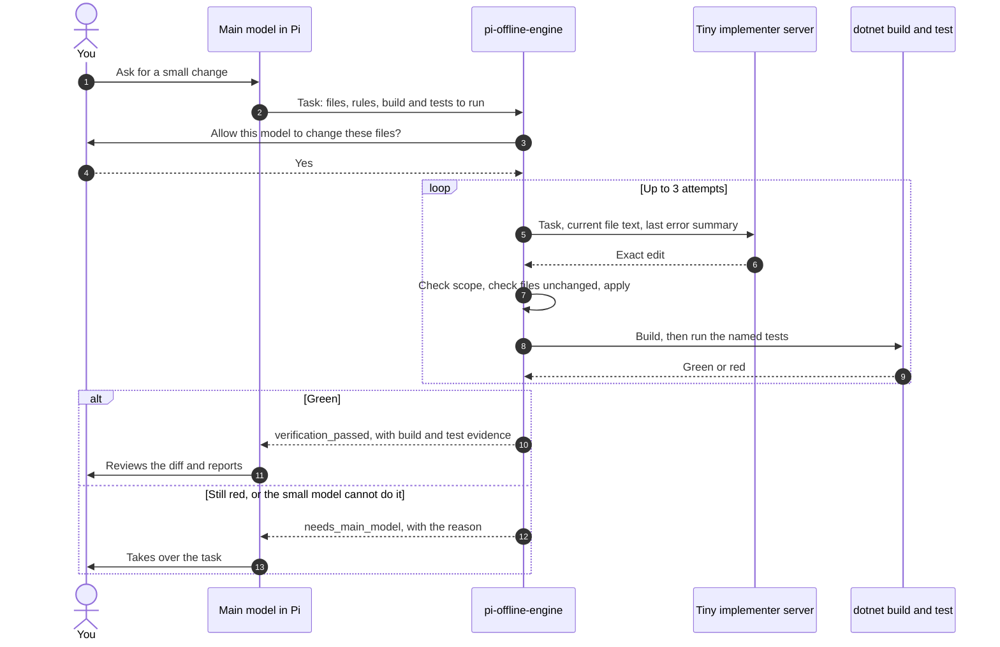
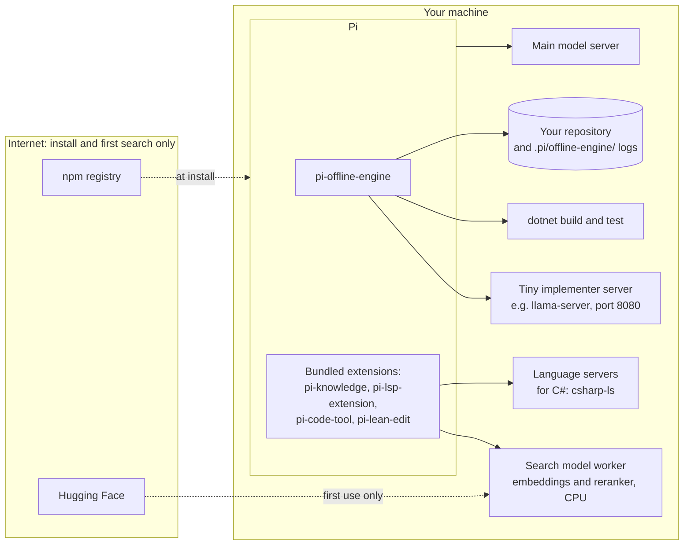
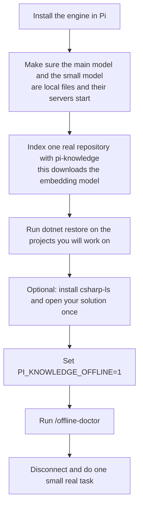

<p align="center">
  
</p>

<h1 align="center">pi-offline-engine</h1>

<p align="center"><b>A big model plans. A small model types. Your compiler and tests decide.</b><br>
An extension for the <a href="https://github.com/earendil-works/pi">Pi coding agent</a> (and a plugin for Claude Code) that makes coding with local models practical, including with no network at all.</p>

<p align="center"><b>English</b> | <a href="docs/REFERENCE.ru.md">Русский (полная справка)</a> · Full reference: <a href="docs/REFERENCE.md">docs/REFERENCE.md</a></p>

---

## The idea in one example

You ask your coding agent: *"Make `RetryPolicy` stop retrying when the request is cancelled."*

1. **The main model plans.** It finds the method, decides what must change and writes a short, strict task: which file, which method, what the code must do, which build and which tests prove it.
2. **You approve once.** The engine asks, in a Pi dialog, whether this small model may change these files. You say yes.
3. **A small model types the patch.** A small coder model running on your machine gets the task and the current text of the file, and returns an exact edit.
4. **Your tools judge it.** The engine applies the edit and runs `dotnet build` and the tests named in the task. Green means done. Red goes back to the small model with a short error summary. There are at most 3 attempts in total: the first try and two repairs.
5. **The main model gets the answer.** Either "verified: build and tests pass", or "could not finish, here is why". It checks the diff and reports to you.

The expensive model never sits in the edit, compile, fix loop. That loop is the cheapest model and your own compiler.

<p align="center">
  
</p>

## Who is who

- **Main model.** The model you already talk to in Pi (or Claude Code). It plans, decides when to delegate and reviews the result. In Pi it is often a large local model that takes many seconds per answer; in Claude Code it is a hosted frontier model.
- **Tiny implementer**, called *the small model* in the rest of this page. A small coder model (for example a 3B one) on a local server. It only writes and repairs edits, never plans.
- **The engine.** This extension. It passes the task to the tiny implementer, applies the edit, runs the build and tests, and reports back.
- **Task.** The strict description of one change: files, rules, build and tests. In the code and the reference it is called `ImplementationSpec`.
- **Verification.** The build and the tests named in the task. Only they decide whether an edit worked.
- **Escalation.** The engine hands the task back to the main model with the answer `needs_main_model`.

## Is it for you?

**A good fit if** your code is .NET and you run a coding agent on a local model, want your code to stay on your machine or need it to keep working on a plane. Also if you use a frontier model in Claude Code and want a local model to take over the mechanical edits.

**Not a fit yet if** your project is not .NET (the engine can only verify with `dotnet build` and `dotnet test`), or the change touches more than two files at once.

**Be aware:** this is an experimental project (version 0.1.1). The whole pipeline is tested end to end, but with a scripted stand-in for the small model. How often a real small model gets a task right has not been measured yet.

## Two ways to use it

| You work in | What you get |
|---|---|
| **Pi** | Everything: the delegation tools, the `/offline-*` commands, help for a slow main model (shorter build output, a repository snapshot, a trimmed tool list), and four bundled extensions: search over your code by meaning (`pi-knowledge`), language-server navigation (`pi-lsp-extension`), small scripts over tools (`pi-code-tool`) and cheaper edits (`pi-lean-edit`). |
| **Claude Code, Codex, Cursor or another MCP client** | The delegation tools and three MCP tools in place of the commands: `offline_doctor`, `offline_status`, `offline_stats`. The Claude Code plugin also shortens build output and adds the repository snapshot. Your frontier model plans; a cheap local model types. The four Pi extensions are not part of this. |

## One delegation, step by step



What each answer means for you:

- **`verification_passed`**: the declared build and tests passed. It does not mean the task is fully done; the main model is told to look at the diff before saying so, and you should too.
- **`needs_main_model`**: the cheap loop gave up and the task goes back to the main model. The reason says why (attempts used up, a broken answer, a build that could not run). If the build stayed red, the last edit is still in your files.
- **`insufficient_spec` or `cannot_safely_implement`**: the small model said it needs more information or cannot do it safely. On the first attempt nothing was changed. On a later attempt the earlier edit stays, the answer becomes `needs_main_model` and it lists the files that were touched.

**Undoing an edit.** The engine never commits, resets or stashes anything in git; it only reads git status. Start a delegation from a clean working tree, then `git diff` shows exactly what the small model changed, `git restore <file>` puts a changed file back, and a file it created is simply deleted.

## What runs on your machine



Four model roles exist. You provide the first two. The other two belong to `pi-knowledge`, the bundled extension that lets the agent search your code by meaning.

| Model | What it does | Default | Can be your own server |
|---|---|---|---|
| **Main model** | Plans, writes the task, reviews the result | Whatever you pick in Pi | It is Pi's model |
| **Tiny implementer** | Writes and repairs the exact edit | `qwen2.5-coder-3b-instruct` on `127.0.0.1:8080` | Yes, any OpenAI-compatible server |
| **Embedding model** | Turns code and search queries into vectors | `multilingual-e5-small`, about 470 MB | Yes, an OpenAI-compatible embeddings endpoint |
| **Reranker** | Re-orders hits in `deep` search, the search mode that adds a reranking step; the agent picks the mode | `ms-marco-MiniLM-L-4-v2`, about 77 MB | Yes, a rerank API |

**What goes over the network, and when:**

- **Install:** npm packages.
- **First search:** the two search models download from Hugging Face the first time they are needed, unless you point them at your own server.
- **Your choice only:** a hosted main model or a hosted tiny implementer, for example through OpenRouter with `PI_OFFLINE_TINY_API_KEY`. Then your prompts and code go to that provider; `/offline-doctor` warns you about it.

Those are all the network uses that the engine and its bundled extensions document; what Pi itself sends is governed by Pi's own settings. Settings for your own search servers, and the sizes: [What gets installed and which models run](docs/REFERENCE.md#what-gets-installed-and-which-models-run).

## Get started in Pi

**You need:**

- Pi (verified with 1.5.0) and Node.js 22.19 or newer. Used on Windows 11 and Linux; macOS has not been tried.
- The .NET SDK for your projects. Tests can use VSTest or Microsoft.Testing.Platform; the latter needs the `Microsoft.Testing.Extensions.TrxReport` package in the test project.
- A local server that speaks the OpenAI API with a small coder model loaded: llama.cpp's `llama-server`, LM Studio or Ollama all do. The default name assumes Qwen2.5-Coder 3B Instruct, but any chat model your server offers can be chosen with `/offline-setup`. Which small model works best, and how much memory it needs, has not been measured yet.

```bash
pi install git:github.com/AndrewMoryakov/pi-offline-engine
llama-server -m <your-small-coder-model>.gguf     # serves on 127.0.0.1:8080
pi
```

On first start the engine looks for a model server on `127.0.0.1` ports 8080, 8081, 1234 (LM Studio) and 11434 (Ollama), picks the first chat model, saves it and tells you in one line what it found. It never probes other machines.

Then, inside Pi:

```text
/offline-doctor
```

It answers one question: *is everything here working?* It checks the small model server, `dotnet` and how your tests run, and whether the bundled tools are loaded, one line per check marked ✓ or ✗. The model server, `dotnet` and the delegation tool must pass; the rest are optional. The usual ✗ fixes: start your model server or point the engine at it with `/offline-setup`, install the .NET SDK, or add the TRX package named above to the test project. The rest are in [Troubleshooting](docs/REFERENCE.md#troubleshooting). `/offline-status` shows where each setting came from.

**Your first task.** Pick something small and testable in one or two files, from a clean git working tree. The main model decides on its own when to delegate, but you can ask directly, for example:

> Delegate this to the small model: make `PriceCalculator.Total` throw `ArgumentNullException` when `order` is null. `PriceCalculatorTests` must pass.

The main model then calls the tool `execute_delegated_implementation`. You see one approval prompt naming the model, the files and the number of attempts; during a delegation that is the only moment the engine asks you anything. The tool's result in Pi shows the outcome, and `/offline-stats` counts the small model's calls, so you can tell a delegated edit from one the main model made itself. A sibling tool, `delegate_implementation`, only proposes a patch and writes nothing, if you want to see what the small model would do first.

Pinning a version for a team or a trip: `pi install git:github.com/AndrewMoryakov/pi-offline-engine@<tag-or-commit>`.

## Get started in Claude Code (or any MCP client)

```text
/plugin marketplace add AndrewMoryakov/pi-offline-engine
/plugin install pi-offline-engine@pi-offline-engine
```

Export `PI_OFFLINE_TINY_ENDPOINT` and `PI_OFFLINE_TINY_MODEL` in the shell you start Claude Code from (the defaults are `http://127.0.0.1:8080` and `qwen2.5-coder-3b-instruct`; there is no automatic discovery outside Pi), then ask Claude to run the `offline_doctor` tool once. The plugin also gives Claude a short guide on when to delegate. Approval comes as a question from the MCP server inside Claude Code; `claude -p` and other runs with nobody to answer do not write, unless `PI_OFFLINE_ALLOW_HEADLESS_APPLY=1` is set. For other MCP clients and the exact behaviour, see [docs/CLAUDE_CODE.md](docs/CLAUDE_CODE.md).

## Going offline

Everything runs locally once a few things are downloaded. Do them while you still have a network:



To index a repository, ask the agent to add it to its knowledge base; that is `pi-knowledge`'s `knowledge_add` tool. If you want `deep` search offline as well, run one `deep` search before you leave; that downloads the reranker. Setting `PI_KNOWLEDGE_OFFLINE=1` too early blocks these downloads, so keep the order. The full checklist is in [docs/OFFLINE_PROFILE.md](docs/OFFLINE_PROFILE.md).

## What the engine will and will not do

- **It changes only the files you approved,** by exact text replacement or by creating a file you allowed. A file that changed while the small model was working is not overwritten.
- **It builds the commands itself.** The task names the project and the tests; the engine turns that into the `dotnet` command line, so a model cannot slip in a shell command.
- **It counts tests as passed only with proof** that tests actually ran: a fresh TRX result file from `dotnet test` with more than zero executed tests, not just a zero exit code.
- **It asks you before writing.** With no screen to ask on, it refuses. `PI_OFFLINE_ALLOW_HEADLESS_APPLY=1` lifts that, and is meant only for a sandbox.
- **It keeps its logs inside your repository** in `.pi/offline-engine/`. The folder contains its own `.gitignore` with `*`, so git never shows it.
- **It does not sandbox your machine.** `dotnet build` and `dotnet test` run in your repository with your permissions, including any build steps your projects define.
- **It does not undo.** If the last attempt stays red, its edit stays in your files.

## For a slow main model

Outside of delegation, the engine also keeps work off the main model:

- Long `dotnet build` and `dotnet test` output is cut down to the errors before the model reads it; the full log stays on disk (`/offline-compact`).
- A small snapshot of the repository (branch, changed files, solution and project files) is added at the start, so the model does not spend its first turns looking around (`/offline-context`).
- `/offline-tools minimal` hides tools a slow model does not need, and `/offline-tools restore` brings them back.
- `/offline-stats` shows what the small model did and how much text was kept out of the main model's context.

## Limits today

- Verification is .NET only.
- At most two files per delegated change, by exact text replacement or file creation only. A task with more files is rejected before anything runs.
- A file over 16 KB is not sent to the small model in full; the main model has to pass the relevant part.
- No automatic rollback.
- `verification_passed` is compiler and test evidence, not proof the task is complete.
- Fewer main-model turns and less text in its context is what the design aims for; it has not been measured with a real small model yet.
- There is no CI; the checks are run by hand before a merge.

## Where to read more

- [docs/REFERENCE.md](docs/REFERENCE.md): every setting, command, environment variable, file on disk and troubleshooting entry.
- [docs/BOUND_DELEGATION_V0.md](docs/BOUND_DELEGATION_V0.md): the exact delegation contract.
- [docs/OFFLINE_PROFILE.md](docs/OFFLINE_PROFILE.md): the bundled extensions, why each was chosen, and the offline checklist.
- [docs/CLAUDE_CODE.md](docs/CLAUDE_CODE.md): the Claude Code plugin and the MCP server.
- [docs/ARCHITECTURE.md](docs/ARCHITECTURE.md): how the code is organised (Russian).
- [docs/TRAINING_DATA.md](docs/TRAINING_DATA.md): optional capture of verified attempts for training a small model; off by default, and it can contain your source code.
