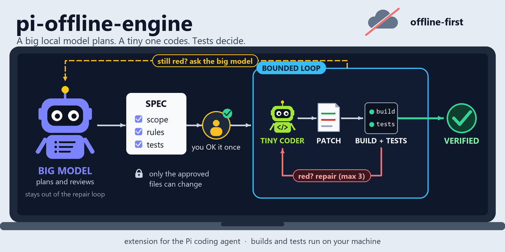
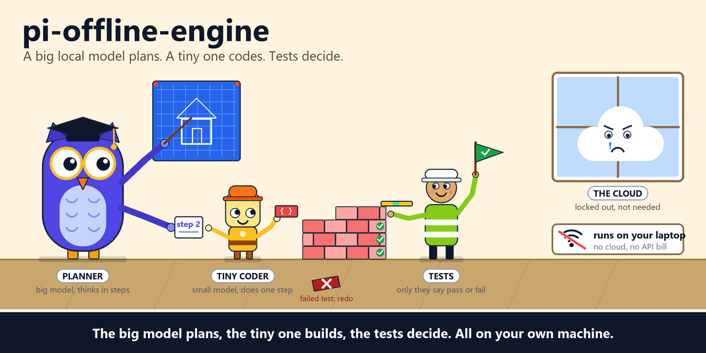
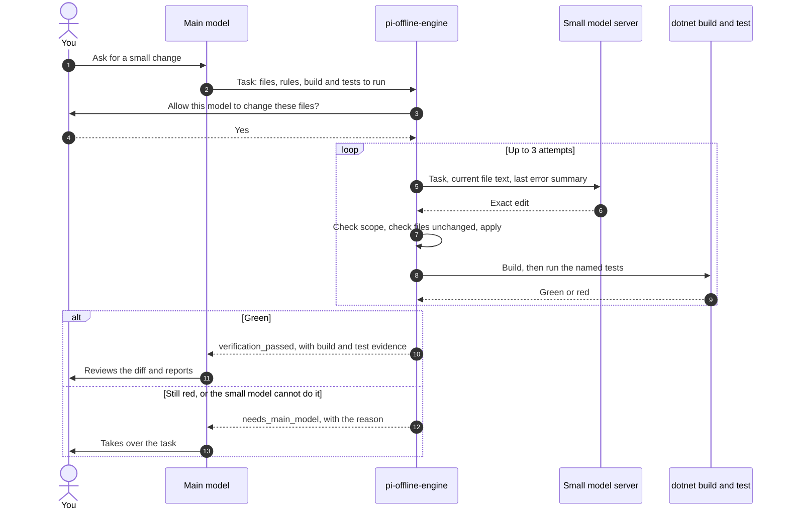
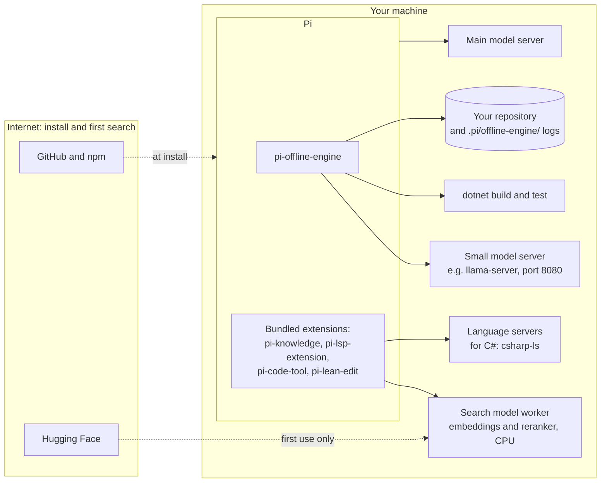
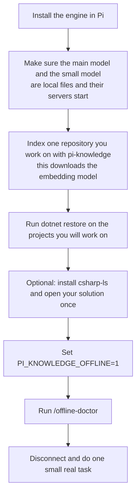

<p align="center">
  
</p>

<h1 align="center">pi-offline-engine</h1>

<p align="center"><b>A big model plans. A small model types. Your compiler and tests decide.</b><br>
An extension for the <a href="https://github.com/earendil-works/pi">Pi coding agent</a> and a plugin for Claude Code. It makes coding with local models practical, even with no network at all. With a paid cloud model as the main model, it saves that model's tokens.</p>

<p align="center"><b>English</b> | <a href="README.ru.md">Русский</a> · Full reference: <a href="docs/REFERENCE.md">docs/REFERENCE.md</a></p>

---

## The idea in one example

You ask your coding agent: *"Make `RetryPolicy` stop retrying when the request is cancelled."*

1. **The main model plans.** It finds the method, decides what must change and writes a short, strict task: which file, which method, what the code must do, which build and which tests prove it. The tool's description tells it to hand small, well-defined changes like this one to the engine, and you can also ask it to.
2. **You approve.** The engine asks, in a dialog, whether this small model may change these files. You say yes. The question comes once per delegation.
3. **A small model types the patch.** A small coder model on your machine gets the task and the current text of the file, and returns an exact edit.
4. **Your tools judge it.** The engine applies the edit and runs `dotnet build` and the tests named in the task. Green means the edit passed the checks. Red goes back to the small model with a short error summary. There are at most 3 attempts: the first try and two repairs.
5. **The main model gets the answer.** Either "verified: build and tests pass", or the task comes back to it with the reason. It checks the diff and reports to you.

The main model never sits in the edit, compile, fix loop. That loop is the cheapest model and your own compiler. This is where both benefits come from: a slow local main model is spared many slow turns, and a paid cloud main model spends no tokens writing mechanical edits or reading compiler output.

<p align="center">
  
</p>

## Who is who

- **Main model.** The model you already talk to in Pi or Claude Code. It plans, decides when to delegate and reviews the result. It can be a large local model or a cloud model such as Claude, GPT or Gemini.
- **Small model** (in settings and the reference: the *tiny implementer*, hence `PI_OFFLINE_TINY_*`). A small coder model, for example a 3B one, on a server on your machine or your local network. It only writes and repairs edits, never plans.
- **The engine.** This extension, `pi-offline-engine`. It passes the task to the small model, applies the edit, runs the build and tests, and reports back.
- **Task.** The strict description of one change: files, rules, build and tests. In the code and the reference it is called `ImplementationSpec`.
- **Verification.** The build and the tests named in the task. Only they decide whether an edit worked.
- **Escalation.** The engine hands the task back to the main model with the answer `needs_main_model`.

## Is it for you?

**It fits if your code is .NET and you want one of these:**

- to run a coding agent on local models, keep your code on your machine, or keep working without a network;
- to spend fewer tokens of a paid cloud model: it plans and reviews, and a small model does the typing and the compile and fix rounds: a local one, or a cheaper Claude model such as Haiku through Claude Code.

**Languages.** Verification works with .NET today (`dotnet build` and `dotnet test`), so delegation is available for .NET projects only. Rust and Python are next.

**Size of a change.** One delegated change touches at most two files. For larger work, the main model can split it into several tasks or do it itself.

## Two ways to use it

| You work in | What you get |
|---|---|
| **Pi**, with a local or cloud main model | Everything: the delegation tools, the `/offline-*` commands, help for a slow main model (shorter build output, a repository snapshot, a trimmed tool list), and four bundled extensions: search over your code by meaning (`pi-knowledge`), language-server navigation (`pi-lsp-extension`), small scripts over tools (`pi-code-tool`) and cheaper edits (`pi-lean-edit`). |
| **Claude Code, Codex, Cursor or another MCP client** | The same two delegation tools; three MCP tools in place of the commands: `offline_doctor`, `offline_status`, `offline_stats`; and `dotnet_build` and `dotnet_test`, which run the build or the tests and return the short result. The Claude Code plugin also shortens build output from the shell and adds the repository snapshot. Your cloud model plans; a local model types. Pi is not needed, and its four bundled extensions are not part of this. |

## One delegation, step by step



What each answer means for you:

- **`verification_passed`**: the declared build and tests passed. It does not mean the task is fully done; the main model is told to look at the diff before saying so, and you should too.
- **`needs_main_model`**: the cheap loop gave up and the task goes back to the main model. The reason says why (attempts used up, a broken answer, a build that could not run). If the build stayed red, the last edit is still in your files.
- **`insufficient_spec` or `cannot_safely_implement`**: the small model said it needs more information or cannot do it safely. On the first attempt nothing was changed. On a later attempt the earlier edit stays, the answer becomes `needs_main_model` and it lists the files that were touched.

**Undoing an edit.** The engine never commits, resets or stashes anything in git; it only reads the repository's state. Start a delegation from a clean working tree (commit or stash your own changes first). Then `git diff` shows exactly what the small model changed, `git restore <file>` puts a changed file back, and a file it created is simply deleted.

## What runs on your machine



The diagram shows a fully local setup in Pi. With a cloud main model, Pi or Claude Code talks to that provider instead of a local main model server; everything else stays the same.

Four models take part. You provide the first two. The other two belong to `pi-knowledge`, the bundled Pi extension that lets the agent search your code by meaning, so they exist in Pi only.

| Model | What it does | Default | On your own server |
|---|---|---|---|
| **Main model** | Plans, writes the task, reviews the result | Whatever you pick in Pi or Claude Code | Yes, you choose it in Pi or Claude Code |
| **Small model** | Writes and repairs the exact edit | `qwen2.5-coder-3b-instruct` on `127.0.0.1:8080` | Yes, any OpenAI-compatible server, or a Claude model through the Claude Code CLI |
| **Embedding model** (Pi only) | Turns code and search queries into vectors | `multilingual-e5-small`, about 470 MB | Yes, an OpenAI-compatible embeddings endpoint |
| **Reranker** (Pi only) | Re-orders hits in `deep` search, the search mode with an extra reranking step; the agent picks the mode for each search | `ms-marco-MiniLM-L-4-v2`, about 77 MB | Yes, a rerank API |

**What goes over the network, and when:**

- **Install:** the engine from GitHub and its npm packages.
- **First search:** the two search models download from Hugging Face the first time they are needed, unless you point them at your own server.
- **Your own setup, once:** the small model file, llama.cpp, the .NET SDK and its NuGet packages (`dotnet restore`), and optionally `csharp-ls`.
- **Your choice only:** a cloud main model, a hosted small model, or a Claude small model through Claude Code (see below). Then your prompts and code go to that provider; `/offline-doctor` warns you when the small model is not on your network.

The engine itself sends requests only to the model servers you configure. The bundled extensions document no network use beyond the search models. What Pi itself sends depends on Pi's own settings. Settings for your own search servers, and the sizes: [What gets installed and which models run](docs/REFERENCE.md#what-gets-installed-and-which-models-run).

## Get started in Pi

**1. Pi and a main model.** If you do not have Pi yet, install it as [its README](https://github.com/earendil-works/pi) describes, for example `npm install -g --ignore-scripts @earendil-works/pi-coding-agent`, and choose your main model there: a cloud one, or a local one with Pi's guide [Local Models with llama.cpp](https://github.com/earendil-works/pi/blob/v1.5.0/packages/coding-agent/docs/llama-cpp.md), which also shows how to install llama.cpp. The engine is verified with Pi 1.5.0 and needs Node.js 22.19 or newer. It has been used on Windows 11 and Linux; macOS has not been tried yet.

**2. The .NET SDK** for your projects. Tests can use VSTest or Microsoft.Testing.Platform; the latter needs the `Microsoft.Testing.Extensions.TrxReport` package in the test project.

**3. A small model and its server.** Any server with an OpenAI-compatible API works: llama.cpp's `llama-server`, LM Studio or Ollama. For example, the 2.1 GB file `qwen2.5-coder-3b-instruct-q4_k_m.gguf` from [Qwen/Qwen2.5-Coder-3B-Instruct-GGUF](https://huggingface.co/Qwen/Qwen2.5-Coder-3B-Instruct-GGUF). That model is published under the Qwen Research license; check that it fits your use, or pick another coder model.

**4. Start the small model** in its own terminal, and leave it running. You can also download the file in a browser; on Windows, type `curl.exe` instead of `curl`:

```bash
curl -LO https://huggingface.co/Qwen/Qwen2.5-Coder-3B-Instruct-GGUF/resolve/main/qwen2.5-coder-3b-instruct-q4_k_m.gguf
llama-server -m qwen2.5-coder-3b-instruct-q4_k_m.gguf --port 8080 -c 32768
```

`-c 32768` is the context size, as in Pi's llama.cpp guide; the task and the current text of two files have to fit in it. If your main model is also served locally, give it a different port.

**5. Install the engine and start Pi** in a second terminal:

```bash
pi install git:github.com/AndrewMoryakov/pi-offline-engine
pi
```

On first start the engine looks for a model server on `127.0.0.1` ports 8080, 8081, 1234 (LM Studio) and 11434 (Ollama). It skips embedding and reranking models, prefers a model with `coder` in its name, saves its choice and tells you in one line what it found. It never probes other machines. Start `pi` from the root of your repository: the engine works on the folder Pi runs in. If your main model is local too, read that one-line message; if it picked the wrong model, set the small one with `/offline-setup http://127.0.0.1:8080 <model>`. The model id is what your server lists at `http://127.0.0.1:8080/v1/models`, and the address works with or without `/v1`.

**6. Check:**

```text
/offline-doctor
```

It answers one question: *is everything here working?* It checks the small model server, `dotnet` and how your tests run, and whether the bundled tools are loaded, one line per check marked ✓ or ✗. The model server, `dotnet` and the delegation tool must pass; the rest are optional. The usual ✗ fixes: start your model server or point the engine at it with `/offline-setup`, install the .NET SDK, or add the TRX package named above to the test project. The rest are in [Troubleshooting](docs/REFERENCE.md#troubleshooting). `/offline-status` shows where each setting came from.

**7. Your first task.** Before the first delegation, the project must already build and its tests must pass, with packages restored by `dotnet restore`: the engine runs `dotnet` with `--no-restore` and never downloads packages itself. Pick something small in one or two files, from a clean git working tree. Tests make it much more useful, but a task can also name only a build, and then only compilation is checked. You can ask directly, for example:

> Delegate this to the small model: make `PriceCalculator.Total` throw `ArgumentNullException` when `order` is null. `PriceCalculatorTests` must pass.

The main model then calls the tool `execute_delegated_implementation`. You see one approval prompt naming the model, the files and the number of attempts; during a delegation that is the only moment the engine asks you anything. Each request to the small model may take up to 120 seconds by default (`PI_OFFLINE_TINY_TIMEOUT_MS` changes that). The tool's result shows the outcome, and `/offline-stats` counts the small model's calls, so you can tell a delegated edit from one the main model made itself. If the main model makes the edit itself instead, ask it explicitly to use `execute_delegated_implementation`. A sibling tool, `delegate_implementation`, only proposes a patch and writes nothing, if you want to see what the small model would do first.

**Updating and removing.** `pi update` updates installed extensions, `pi list` shows them, and `pi remove git:github.com/AndrewMoryakov/pi-offline-engine` removes the engine. For a team or a trip, pin a version: `pi install git:github.com/AndrewMoryakov/pi-offline-engine@<tag-or-commit>`.

**A hosted small model instead of a local one.** Before starting `pi`, set `PI_OFFLINE_TINY_ENDPOINT=https://openrouter.ai/api/v1`, `PI_OFFLINE_TINY_MODEL` to an exact model id from OpenRouter's catalog (for example `qwen/qwen3-coder-30b-a3b-instruct`) and `PI_OFFLINE_TINY_API_KEY`. Your code then goes to that provider. Details: [Hosted routers](docs/REFERENCE.md#hosted-openai-compatible-routers-openrouter).

## Get started in Claude Code (or any MCP client)

You need Node.js 22.19 or newer, the .NET SDK and a running small model server, as in steps 2 to 4 above. Pi is not needed.

```text
/plugin marketplace add AndrewMoryakov/pi-offline-engine
/plugin install pi-offline-engine@pi-offline-engine
```

There is no automatic discovery outside Pi; the defaults are `http://127.0.0.1:8080` and the model id `qwen2.5-coder-3b-instruct`. If your server lists another id at `http://127.0.0.1:8080/v1/models`, or runs elsewhere, set `PI_OFFLINE_TINY_MODEL` and `PI_OFFLINE_TINY_ENDPOINT` in the shell you start Claude Code from: `export NAME=value` in bash, `$env:NAME = "value"` in PowerShell. Start Claude Code from the root of your repository and ask Claude to run the `offline_doctor` tool once. If it answers, the plugin's MCP server is running, and it tells you when the model id does not match. The tools have the same names as in Pi, and the plugin gives Claude a short guide on when to delegate. Approval comes as a question from the MCP server inside Claude Code; `claude -p` and other runs with nobody to answer do not write, unless `PI_OFFLINE_ALLOW_HEADLESS_APPLY=1` is set. **No local model server? Use Haiku through Claude Code itself.** Set `PI_OFFLINE_TINY_PROVIDER=claude-code`. The engine then runs `claude -p` once per request on the same machine, with no tools, no MCP servers and no user settings, and asks it for the edit as strict JSON. The model is `claude-haiku-5-5` unless `PI_OFFLINE_TINY_MODEL` names another. Nothing has to be served, the Claude Code login you already have is used, and the source goes to Anthropic like the rest of the session; `offline_doctor` says so. A main model such as Sonnet then plans and reviews while Haiku types. The same setting works in Pi if the `claude` CLI is installed and logged in.

Update or remove the plugin with Claude Code's `/plugin` command. Other MCP clients must support MCP elicitation, the way an MCP server asks you a question; with a client that cannot ask, delegated writes are refused. Setup for other clients and the exact behaviour: [docs/CLAUDE_CODE.md](docs/CLAUDE_CODE.md).

## Going offline

Once a few things are downloaded, a fully local setup needs no network. Do them while you still have one:



To index a repository, ask the agent to add it to its knowledge base; that is `pi-knowledge`'s `knowledge_add` tool. If you want `deep` search offline as well, run one `deep` search while you are still online; that downloads the reranker. `PI_KNOWLEDGE_OFFLINE=1` is an environment variable for the shell you start `pi` from. Set too early, it blocks these downloads, so keep the order. Installing `csharp-ls` and the full checklist are in [docs/OFFLINE_PROFILE.md](docs/OFFLINE_PROFILE.md).

## What the engine will and will not do

- **It changes only the files you approved,** by exact text replacement or by creating a file you allowed. If a file changed while the small model was working, the edit is not applied and the task goes back to the main model.
- **It builds the commands itself.** The task names the project and the tests; the engine turns that into the `dotnet` command line, so a model cannot slip in a shell command. The edited code itself does run during the build and tests.
- **It counts tests as passed only with proof** that tests actually ran: a fresh TRX result file from `dotnet test` with more than zero executed tests, not just a zero exit code.
- **It asks you before writing.** With no screen to ask on, it refuses. `PI_OFFLINE_ALLOW_HEADLESS_APPLY=1` lifts that, and is meant only for a sandbox.
- **It keeps its logs inside your repository** in `.pi/offline-engine/`. The folder contains its own `.gitignore` with `*`, so git never shows it. Only the newest 20 logs of each kind are kept (`PI_OFFLINE_STATE_KEEP` changes the number), so the folder stays small and a plain `grep -r` in your repository runs into few of them.
- **It does not sandbox your machine.** `dotnet build` and `dotnet test` run in your repository with your permissions, including any build steps your projects define.

## For a slow main model

Outside of delegation, the engine also takes work off the main model:

- Long `dotnet build` and `dotnet test` output is cut down before the model reads it: the result first, then the compiler errors with file and line, and each failed test with its expected and actual values and its line in the test file. The full log stays on disk (`/offline-compact`). In Claude Code a failed command run through the shell reaches the model in full, so the `dotnet_build` and `dotnet_test` tools do the build and the tests there.
- A small snapshot of the repository (branch, changed files, solution and project files) is added at the start, so the model does not spend its first turns looking around (`/offline-context`).
- `/offline-tools minimal` hides tools a slow model does not need, and `/offline-tools restore` brings them back.
- `/offline-stats` shows what the small model did and how much text was kept out of the main model's context.

## Limits today

- Verification is .NET only; Rust and Python are next.
- At most two files per delegated change, by exact text replacement or file creation only. A task with more files is rejected before anything runs.
- A file over 16 KB is not sent to the small model in full; the main model passes the relevant part in the task instead.
- No automatic rollback.
- `verification_passed` is compiler and test evidence, not proof the task is complete.

## Where to read more

- [docs/REFERENCE.md](docs/REFERENCE.md): every setting, command, environment variable, file on disk and troubleshooting entry.
- [docs/BOUND_DELEGATION_V0.md](docs/BOUND_DELEGATION_V0.md): the exact delegation contract, including the task format.
- [docs/OFFLINE_PROFILE.md](docs/OFFLINE_PROFILE.md): the bundled extensions, why each was chosen, and the offline checklist.
- [docs/CLAUDE_CODE.md](docs/CLAUDE_CODE.md): the Claude Code plugin and the MCP server.
- [docs/ARCHITECTURE.md](docs/ARCHITECTURE.md): how the code is organised (Russian).
- [docs/TRAINING_DATA.md](docs/TRAINING_DATA.md): optional capture of verified attempts for training a small model; off by default, and it can contain your source code.
