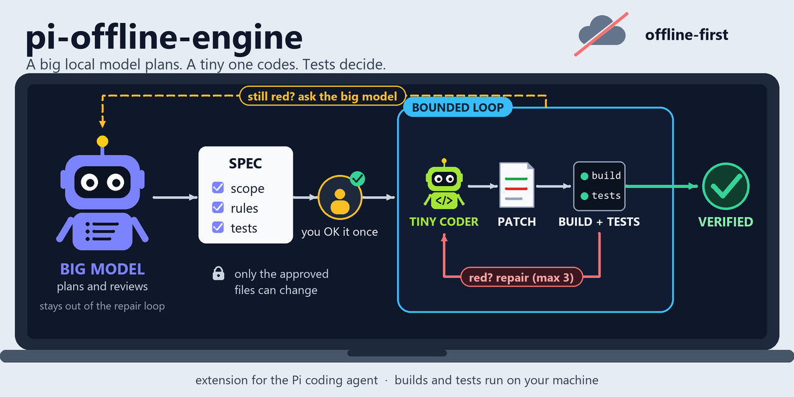
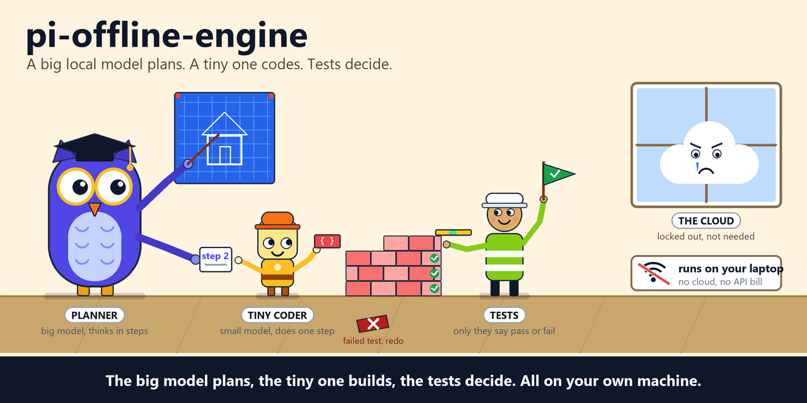
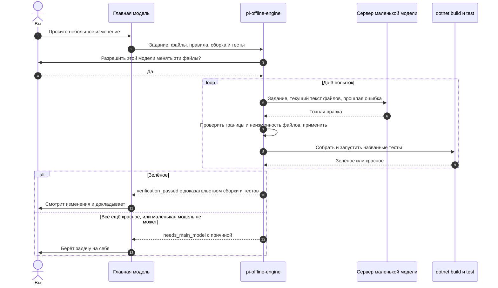
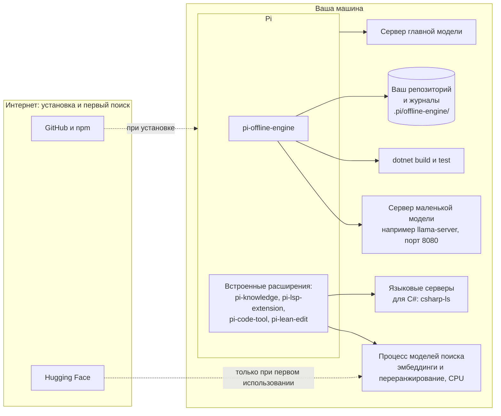
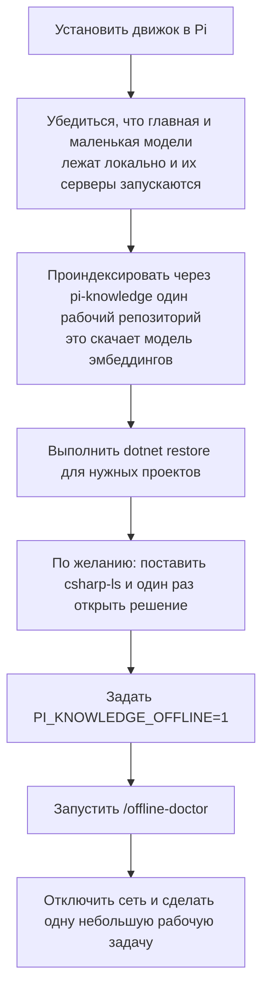

<p align="center">
  
</p>

<h1 align="center">pi-offline-engine</h1>

<p align="center"><b>Большая модель планирует. Маленькая печатает. Решают ваш компилятор и тесты.</b><br>
Расширение для агента <a href="https://github.com/earendil-works/pi">Pi</a> и плагин для Claude Code. С ним на локальных моделях можно по-настоящему писать код, даже совсем без сети. А если главная модель платная облачная, расширение экономит её токены.</p>

<p align="center"><a href="README.md">English</a> | <b>Русский</b> · Полная справка: <a href="docs/REFERENCE.ru.md">docs/REFERENCE.ru.md</a></p>

---

## Идея на одном примере

Вы просите агента: *«Сделай так, чтобы `RetryPolicy` не повторял запрос после отмены»*.

1. **Главная модель планирует.** Она находит метод, решает, что поменять, и пишет короткое строгое задание: какой файл, какой метод, что должен делать код, какая сборка и какие тесты это докажут. Описание инструмента подсказывает ей передавать такие небольшие и ясные изменения движку, а вы можете попросить об этом и сами.
2. **Вы одобряете.** Движок спрашивает в диалоге, можно ли этой маленькой модели менять эти файлы. Вы отвечаете «да». Вопрос задаётся один раз на каждое делегирование.
3. **Маленькая модель печатает правку.** Небольшая модель для кода на вашей машине получает задание и текущий текст файла и возвращает точную правку.
4. **Решают ваши инструменты.** Движок применяет правку и запускает `dotnet build` и тесты из задания. Зелёное значит, что правка прошла проверку. Красное уходит обратно маленькой модели с коротким описанием ошибки. Попыток не больше трёх: первая и две на исправление.
5. **Главная модель получает ответ.** Либо «проверено: сборка и тесты проходят», либо задача возвращается к ней с причиной. Она смотрит изменения и докладывает вам.

Главная модель не участвует в цикле «правка, сборка, исправление». В нём работают самая дешёвая модель и ваш собственный компилятор. Отсюда обе выгоды: медленной локальной главной модели не приходится делать множество медленных ходов, а платная облачная не тратит токены на механические правки и чтение вывода компилятора.

<p align="center">
  
</p>

## Кто есть кто

- **Главная модель.** Та, с которой вы уже работаете в Pi или Claude Code. Она планирует, решает, когда делегировать, и проверяет результат. Это может быть большая локальная модель или облачная, например Claude, GPT или Gemini.
- **Маленькая модель** (в настройках и справочнике: *крошечный исполнитель*, отсюда переменные `PI_OFFLINE_TINY_*`). Небольшая модель для кода, например на 3B параметров, на сервере на вашей машине или в вашей локальной сети. Она только пишет и исправляет правки и никогда не планирует.
- **Движок.** Это расширение, `pi-offline-engine`. Он передаёт задание маленькой модели, применяет правку, запускает сборку и тесты и сообщает результат.
- **Задание.** Строгое описание одного изменения: файлы, правила, сборка и тесты. В коде и в справочнике оно называется `ImplementationSpec`.
- **Проверка.** Сборка и тесты, названные в задании. Только они решают, сработала ли правка.
- **Эскалация.** Движок возвращает задание главной модели с ответом `needs_main_model`.

## Подходит ли вам

**Подходит, если ваш код на .NET и вы хотите одного из двух:**

- работать с агентом на локальных моделях, держать код у себя или работать без сети;
- тратить меньше токенов платной облачной модели: она планирует и проверяет, а локальная модель печатает правки и проходит круги сборки и исправления.

**Языки.** Проверка сейчас работает с .NET (`dotnet build` и `dotnet test`), поэтому делегировать можно только в проектах .NET. Следующие на очереди Rust и Python.

**Размер изменения.** Одно делегированное изменение затрагивает не больше двух файлов. Большую работу главная модель может разбить на несколько заданий или сделать сама.

## Два способа использования

| Где вы работаете | Что вы получаете |
|---|---|
| **Pi**, с локальной или облачной главной моделью | Всё: инструменты делегирования, команды `/offline-*`, помощь медленной главной модели (короткий вывод сборки, снимок репозитория, сокращённый список инструментов) и четыре встроенных расширения: поиск по коду по смыслу (`pi-knowledge`), навигация через языковой сервер (`pi-lsp-extension`), маленькие скрипты поверх инструментов (`pi-code-tool`) и более дешёвые правки (`pi-lean-edit`). |
| **Claude Code, Codex, Cursor или другой MCP-клиент** | Те же два инструмента делегирования и три MCP-инструмента вместо команд: `offline_doctor`, `offline_status`, `offline_stats`. Плагин для Claude Code также сокращает вывод сборки и добавляет снимок репозитория. Облачная модель планирует, локальная печатает. Pi не нужен, и его четырёх встроенных расширений здесь нет. |

## Одно делегирование по шагам



Что значит каждый ответ:

- **`verification_passed`**: заявленные сборка и тесты прошли. Это не значит, что задача полностью решена. Главной модели велено посмотреть изменения, прежде чем так говорить, и вам стоит посмотреть тоже.
- **`needs_main_model`**: дешёвый цикл сдался, и задача возвращается главной модели. Причина объясняет почему (попытки кончились, ответ модели негодный, сборку не удалось запустить). Если сборка осталась красной, последняя правка остаётся в ваших файлах.
- **`insufficient_spec` или `cannot_safely_implement`**: маленькая модель ответила, что ей не хватает сведений или что безопасно это не сделать. Если это первая попытка, ничего не изменено. Если более поздняя, прежняя правка остаётся, ответ становится `needs_main_model`, и в нём перечислены затронутые файлы.

**Как отменить правку.** Движок ничего не коммитит и ничего не откатывает в git, он только читает состояние репозитория. Начинайте делегирование с чистого рабочего дерева (свои изменения сначала закоммитьте или уберите в stash). Тогда `git diff` покажет ровно то, что изменила маленькая модель, `git restore <файл>` вернёт изменённый файл, а созданный ею файл достаточно удалить.

## Что работает на вашей машине



На схеме полностью локальная конфигурация в Pi. С облачной главной моделью Pi или Claude Code обращаются к её провайдеру вместо локального сервера главной модели, остальное не меняется.

В работе участвуют четыре модели. Первые две предоставляете вы. Остальные две принадлежат `pi-knowledge`, встроенному расширению Pi для поиска по коду по смыслу, поэтому они есть только в Pi.

| Модель | Что делает | По умолчанию | На своём сервере |
|---|---|---|---|
| **Главная модель** | Планирует, пишет задание, проверяет результат | Та, что выбрана в Pi или Claude Code | Да, вы выбираете её в Pi или Claude Code |
| **Маленькая модель** | Пишет и исправляет точную правку | `qwen2.5-coder-3b-instruct` на `127.0.0.1:8080` | Да, любой сервер с OpenAI-совместимым API |
| **Модель эмбеддингов** (только Pi) | Превращает код и поисковые запросы в векторы | `multilingual-e5-small`, около 470 МБ | Да, OpenAI-совместимая точка эмбеддингов |
| **Переранжирование** (только Pi) | Переупорядочивает найденное в режиме поиска `deep` (в нём есть дополнительный шаг переранжирования; какой режим нужен, агент решает сам при каждом поиске) | `ms-marco-MiniLM-L-4-v2`, около 77 МБ | Да, API переранжирования |

**Что и когда идёт по сети:**

- **Установка:** движок с GitHub и его пакеты npm.
- **Первый поиск:** две модели поиска скачиваются с Hugging Face при первой необходимости, если вы не направили их на свой сервер.
- **Ваша собственная подготовка, один раз:** файл маленькой модели, llama.cpp, .NET SDK и пакеты NuGet (`dotnet restore`), по желанию `csharp-ls`.
- **Только по вашему выбору:** облачная главная модель или облачная маленькая модель (см. ниже). Тогда ваши запросы и код уходят этому провайдеру; `/offline-doctor` предупреждает, если маленькая модель не в вашей сети.

Сам движок обращается только к тем серверам моделей, которые вы настроили. Встроенные расширения других обращений к сети, кроме моделей поиска, не описывают. Что отправляет сам Pi, зависит от его настроек. Свои серверы для поиска и размеры моделей: [Что устанавливается и какие модели запускаются](docs/REFERENCE.ru.md#что-устанавливается-и-какие-модели-запускаются).

## Начать в Pi

**1. Pi и главная модель.** Если Pi ещё нет, установите его, как сказано в [его README](https://github.com/earendil-works/pi), например `npm install -g --ignore-scripts @earendil-works/pi-coding-agent`, и выберите там главную модель: облачную или локальную по руководству Pi [Local Models with llama.cpp](https://github.com/earendil-works/pi/blob/v1.5.0/packages/coding-agent/docs/llama-cpp.md). Там же сказано, как установить llama.cpp. Движок проверен с Pi 1.5.0 и требует Node.js 22.19 или новее. Он использовался на Windows 11 и Linux; на macOS ещё не запускался.

**2. .NET SDK** для ваших проектов. Тесты могут работать через VSTest или Microsoft.Testing.Platform; для второго в тестовом проекте нужен пакет `Microsoft.Testing.Extensions.TrxReport`.

**3. Маленькая модель и её сервер.** Подойдёт любой сервер с OpenAI-совместимым API: `llama-server` из llama.cpp, LM Studio или Ollama. Например, файл `qwen2.5-coder-3b-instruct-q4_k_m.gguf` на 2,1 ГБ из [Qwen/Qwen2.5-Coder-3B-Instruct-GGUF](https://huggingface.co/Qwen/Qwen2.5-Coder-3B-Instruct-GGUF). Эта модель выпущена под лицензией Qwen Research; проверьте, подходит ли она для вашего использования, или возьмите другую модель для кода.

**4. Запустите маленькую модель** в отдельном терминале и не закрывайте его. Файл можно скачать и в браузере; в Windows вместо `curl` пишите `curl.exe`:

```bash
curl -LO https://huggingface.co/Qwen/Qwen2.5-Coder-3B-Instruct-GGUF/resolve/main/qwen2.5-coder-3b-instruct-q4_k_m.gguf
llama-server -m qwen2.5-coder-3b-instruct-q4_k_m.gguf --port 8080 -c 32768
```

`-c 32768` задаёт размер контекста, как в руководстве Pi по llama.cpp: в него должны поместиться задание и текущий текст двух файлов. Если главная модель тоже работает локально, дайте ей другой порт.

**5. Установите движок и запустите Pi** во втором терминале:

```bash
pi install git:github.com/AndrewMoryakov/pi-offline-engine
pi
```

При первом запуске движок ищет сервер модели на `127.0.0.1` на портах 8080, 8081, 1234 (LM Studio) и 11434 (Ollama). Модели эмбеддингов и переранжирования он пропускает, предпочитает модель со словом `coder` в названии, запоминает выбор и одной строкой сообщает, что нашёл. Другие машины он не опрашивает. Запускайте `pi` из корня вашего репозитория: движок работает с той папкой, в которой запущен Pi. Если главная модель тоже локальная, прочитайте это сообщение; если выбрана не та модель, задайте маленькую через `/offline-setup http://127.0.0.1:8080 <модель>`. Имя модели это то, что ваш сервер перечисляет по адресу `http://127.0.0.1:8080/v1/models`, а адрес можно писать и с `/v1`, и без него.

**6. Проверка:**

```text
/offline-doctor
```

Она отвечает на один вопрос: *всё ли здесь работает?* Проверяет сервер маленькой модели, `dotnet` и способ запуска тестов, загружены ли встроенные инструменты, по строке на проверку со значком ✓ или ✗. Сервер модели, `dotnet` и инструмент делегирования обязательны, остальное по желанию. Обычные исправления для ✗: запустить сервер модели или указать его через `/offline-setup`, поставить .NET SDK, добавить в тестовый проект пакет TRX, названный выше. Остальное в разделе [Диагностика неполадок](docs/REFERENCE.ru.md#диагностика-неполадок). `/offline-status` показывает, откуда взялась каждая настройка.

**7. Первая задача.** До первого делегирования проект уже должен собираться, его тесты проходить, а пакеты быть восстановлены через `dotnet restore`: движок запускает `dotnet` с `--no-restore` и сам пакеты не скачивает. Выберите что-то небольшое в одном-двух файлах, на чистом рабочем дереве git. С тестами проверка намного полезнее, но в задании можно указать и только сборку: тогда проверяется лишь компиляция. Можно попросить прямо, например:

> Передай маленькой модели: пусть `PriceCalculator.Total` бросает `ArgumentNullException`, если `order` равен null. `PriceCalculatorTests` должны пройти.

Главная модель вызовет инструмент `execute_delegated_implementation`. Вы увидите один вопрос с названием модели, списком файлов и числом попыток; во время делегирования это единственный момент, когда движок что-то у вас спрашивает. Каждый запрос к маленькой модели по умолчанию может длиться до 120 секунд (это меняет `PI_OFFLINE_TINY_TIMEOUT_MS`). Результат инструмента показывает исход, а `/offline-stats` считает вызовы маленькой модели, так что видно, сделала правку она или главная модель сама. Если главная модель правит сама, попросите её явно использовать `execute_delegated_implementation`. Соседний инструмент, `delegate_implementation`, только предлагает правку и ничего не записывает: удобно, если сначала хочется посмотреть, что сделала бы маленькая модель.

**Обновление и удаление.** `pi update` обновляет установленные расширения, `pi list` их показывает, а `pi remove git:github.com/AndrewMoryakov/pi-offline-engine` удаляет движок. Для команды или поездки закрепите версию: `pi install git:github.com/AndrewMoryakov/pi-offline-engine@<тег-или-коммит>`.

**Облачная маленькая модель вместо локальной.** До запуска `pi` задайте `PI_OFFLINE_TINY_ENDPOINT=https://openrouter.ai/api/v1`, в `PI_OFFLINE_TINY_MODEL` точный идентификатор модели из каталога OpenRouter (например `qwen/qwen3-coder-30b-a3b-instruct`) и `PI_OFFLINE_TINY_API_KEY`. Тогда ваш код уходит этому провайдеру. Подробнее: [Облачные роутеры](docs/REFERENCE.ru.md#хостовые-openai-совместимые-роутеры-openrouter).

## Начать в Claude Code (или другом MCP-клиенте)

Понадобятся Node.js 22.19 или новее, .NET SDK и работающий сервер маленькой модели, как в шагах 2, 3 и 4 выше. Pi не нужен.

```text
/plugin marketplace add AndrewMoryakov/pi-offline-engine
/plugin install pi-offline-engine@pi-offline-engine
```

Вне Pi автоматического поиска сервера нет; по умолчанию используются адрес `http://127.0.0.1:8080` и имя модели `qwen2.5-coder-3b-instruct`. Если ваш сервер по адресу `http://127.0.0.1:8080/v1/models` перечисляет другое имя или работает в другом месте, задайте `PI_OFFLINE_TINY_MODEL` и `PI_OFFLINE_TINY_ENDPOINT` в той оболочке, из которой запускаете Claude Code: `export ИМЯ=значение` в bash, `$env:ИМЯ = "значение"` в PowerShell. Запустите Claude Code из корня вашего репозитория и один раз попросите Claude вызвать инструмент `offline_doctor`. Если он ответил, MCP-сервер плагина работает, и он же скажет, если имя модели не совпало. Инструменты называются так же, как в Pi, а плагин даёт Claude короткую памятку, когда делегировать. Одобрение приходит вопросом от MCP-сервера внутри Claude Code; `claude -p` и другие запуски, где отвечать некому, ничего не записывают, если не задан `PI_OFFLINE_ALLOW_HEADLESS_APPLY=1`. Обновить или удалить плагин можно командой Claude Code `/plugin`. Другие MCP-клиенты должны поддерживать MCP elicitation, то есть уметь показать вам вопрос от MCP-сервера; если клиент спросить не может, запись при делегировании отклоняется. Настройка других клиентов и точное поведение: [docs/CLAUDE_CODE.md](docs/CLAUDE_CODE.md).

## Подготовка к работе без сети

Когда нужное скачано, полностью локальной конфигурации сеть не нужна. Скачайте всё заранее, пока сеть есть:



Чтобы проиндексировать репозиторий, попросите агента добавить его в базу знаний; это инструмент `knowledge_add` из `pi-knowledge`. Если без сети нужен и поиск `deep`, выполните один такой поиск, пока сеть есть: он скачает модель переранжирования. `PI_KNOWLEDGE_OFFLINE=1` это переменная окружения в той оболочке, из которой вы запускаете `pi`. Если задать её слишком рано, эти скачивания будут заблокированы, поэтому соблюдайте порядок. Как поставить `csharp-ls`, и полный список подготовки: [docs/OFFLINE_PROFILE.md](docs/OFFLINE_PROFILE.md).

## Что движок делает и чего не делает

- **Меняет только одобренные файлы:** точной заменой текста или созданием разрешённого файла. Если файл изменился, пока работала маленькая модель, правка не применяется, и задача возвращается главной модели.
- **Сам составляет команды.** В задании названы проект и тесты, а командную строку `dotnet` строит движок, поэтому модель не может подсунуть команду оболочки. При этом изменённый код, конечно, выполняется во время сборки и тестов.
- **Считает тесты пройденными только с доказательством**, что они действительно выполнялись: свежий файл результатов TRX от `dotnet test`, где выполнено больше нуля тестов, а не просто нулевой код выхода.
- **Спрашивает перед записью.** Если спросить негде, он отказывается. `PI_OFFLINE_ALLOW_HEADLESS_APPLY=1` снимает этот запрет и предназначен только для изолированной среды.
- **Хранит журналы внутри репозитория** в `.pi/offline-engine/`. В папке лежит собственный `.gitignore` со строкой `*`, поэтому git её не показывает.
- **Не изолирует вашу машину.** `dotnet build` и `dotnet test` выполняются в вашем репозитории с вашими правами, включая шаги сборки, заданные в ваших проектах.

## Для медленной главной модели

Вне делегирования движок тоже разгружает главную модель:

- Длинный вывод `dotnet build` и `dotnet test` сокращается до ошибок, прежде чем его прочитает модель; полный журнал остаётся на диске (`/offline-compact`).
- В начале добавляется короткий снимок репозитория (ветка, изменённые файлы, файлы решений и проектов), чтобы модель не тратила первые ходы на осмотр (`/offline-context`).
- `/offline-tools minimal` прячет инструменты, которые медленной модели не нужны, а `/offline-tools restore` возвращает их.
- `/offline-stats` показывает, что сделала маленькая модель и сколько текста не попало в контекст главной.

## Ограничения сейчас

- Проверка только для .NET; следующие Rust и Python.
- Не больше двух файлов на одно делегированное изменение, только точная замена текста или создание файла. Задание с большим числом файлов отклоняется до любых действий.
- Файл больше 16 КБ не передаётся маленькой модели целиком; вместо этого главная модель передаёт в задании нужный фрагмент.
- Автоматического отката нет.
- `verification_passed` подтверждает, что прошли компиляция и тесты, а не то, что задача решена.

## Что почитать дальше

- [docs/REFERENCE.ru.md](docs/REFERENCE.ru.md): все настройки, команды, переменные окружения, файлы на диске и диагностика неполадок.
- [docs/BOUND_DELEGATION_V0.md](docs/BOUND_DELEGATION_V0.md): точный контракт делегирования, включая формат задания (на английском).
- [docs/OFFLINE_PROFILE.md](docs/OFFLINE_PROFILE.md): встроенные расширения, почему выбрано каждое, и полный список подготовки к работе без сети (на английском).
- [docs/CLAUDE_CODE.md](docs/CLAUDE_CODE.md): плагин для Claude Code и MCP-сервер (на английском).
- [docs/ARCHITECTURE.md](docs/ARCHITECTURE.md): как устроен код.
- [docs/TRAINING_DATA.md](docs/TRAINING_DATA.md): необязательная запись проверенных попыток для обучения маленькой модели; по умолчанию выключена и может содержать ваш исходный код (на английском).
