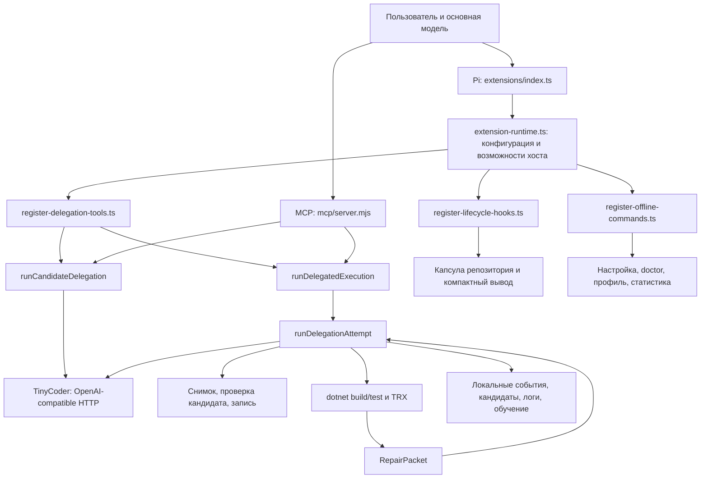
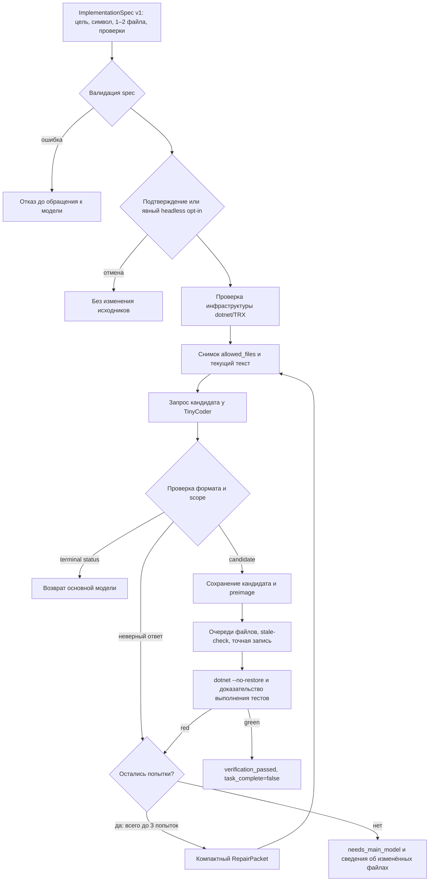

# Карта pi-offline-engine

Карта составлена 2026-10-21 по импортам, точкам регистрации и тестам проекта.
Она описывает устройство кода; результаты запусков и решение по обновлению
хоста вынесены в [PI_COMPATIBILITY_2026-10-21.md](PI_COMPATIBILITY_2026-10-21.md).

## Общая схема

`src/` не импортирует Pi, TypeBox или SDK MCP. Адаптеры передают функции
HTTP-запроса, запуска процессов, подтверждения и очередей записи. Историческое
имя `pi-usage.mjs` обозначает преобразование обычных объектов статистики;
зависимости от Pi внутри этого модуля нет.

## Маршрут одного изменения

Транспортные и инфраструктурные ошибки не считаются обычным неверным ответом
модели и не запускают такой же повтор. После красной проверки уже применённая
правка остаётся в workspace; следующий снимок содержит её. Откат в
`apply-candidate.mjs` относится к сбою самой записи, а не к неуспешным тестам.
`delegate_implementation` проходит отдельный маршрут: проверяет и сохраняет
кандидата, но не применяет его и не запускает build/test.

## Карта кода

| Область | Файлы | Ответственность |
|---|---|---|
| Сборка Pi-расширения | `extensions/index.ts`, `extension-runtime.ts` | Снимок конфигурации при импорте; отдельное mutable state на factory; регистрация tools → hooks → commands; `pi.exec` и `withFileMutationQueue` |
| Инструменты Pi | `extensions/register-delegation-tools.ts`, `delegation-schema.ts` | TypeBox-параметры, подтверждение, headless-отказ, прогресс, вызов workflow и перевод результата |
| Lifecycle | `extensions/register-lifecycle-hooks.ts` | Автонастройка при старте, капсула до запуска, сброс fingerprint при compaction/tree, удаление старых капсул из context, сжатие shell output |
| Команды | `extensions/register-offline-commands.ts` | Восемь `/offline-*` команд: setup, status, doctor, context, compact, tools, training, stats |
| Совместимость edit | `extensions/pi-lean-edit.ts`, `src/edit-routing.mjs`, `tool-schema.mjs` | Выбор lean/none/hybrid, переименование edit → line_edit, плоская схема для локальных парсеров, активация script-edit по модели |
| План и кандидат | `src/implementation-spec.mjs` | Проверка путей, области максимум двух файлов, допустимых операций, цели и verification; проверка кандидата |
| Candidate-only workflow | `src/delegation-candidate-workflow.mjs` | Отказ по spec, чтение разрешённых файлов, запрос, проверка и сохранение кандидата без применения |
| Полный workflow | `src/delegation-execution-workflow.mjs` | Preflight, состояние между попытками, накопление файлов и usage, решение о ремонте/эскалации/успехе |
| Одна попытка | `src/delegation-attempt.mjs` | Snapshot → TinyCoder → validation → candidate record → apply → verification; классификация этапа ошибки и обучение |
| Результаты и переходы | `src/delegation-state.mjs`, `delegation-retry.mjs`, `delegation-results.mjs`, `repair-packet.mjs` | Причины отказов, bounded retry, сохранение предыдущей диагностики, контент/details для хостов |
| Файловая граница | `src/workspace-snapshot.mjs`, `apply-candidate.mjs`, `candidate-store.mjs` | SHA-256, symlink/stale-check, ровно одно совпадение expected, literal replacement, план до записи, rollback при write error, запись evidence |
| Малая модель | `src/tiny-client.mjs`, `endpoint-url.mjs` | OpenAI-compatible chat completions, JSON-кандидат, structured-output fallback, таймаут/abort, редактирование секретов в ошибках |
| Конфигурация и поиск | `src/engine-config.mjs`, `engine-setup.mjs`, `endpoint-discovery.mjs`, `endpoint-locality.mjs`, `agent-dir.mjs` | env > сохранённый config > defaults; ключи только из env; поиск loopback-серверов; распознавание локальных адресов |
| Готовность | `src/offline-doctor.mjs` | Endpoint/model/locality, dotnet и runner, ignore state-dir, C# LSP, наличие companion tools |
| Проверка C# | `src/verification.mjs`, `node-exec.mjs` | Построение argv без shell, project-qualified runner detection, VSTest/MTP, свежие TRX и выполненные test identities, полные логи |
| Контекст и инструменты | `src/repo-capsule.mjs`, `tool-result-compactor.mjs`, `tool-profile.mjs`, `extension-policy.mjs` | Детерминированные Git-факты, диагностика большого dotnet output, минимальный набор tools, read-only guidelines для Python code tool |
| Учёт | `src/event-log.mjs`, `stats.mjs`, `pi-usage.mjs` | Локальный JSONL ledger, агрегация попыток/экономии/токенов, преобразование usage для Pi |
| Обучение | `src/training-recorder.mjs`, `training-exporter.mjs`, `scripts/export-training-data.mjs` | Opt-in полных попыток, пропуск чувствительных путей, best-effort запись, фильтрация/дедупликация/redaction при экспорте |
| MCP-адаптер | `mcp/server.mjs`, `stdio-server.mjs`, `delegation-json-schema.mjs`, `src/state-dir.mjs` | Те же workflows через JSON-RPC stdio, roots/workspace resolution, elicitation, отмена, self-ignored state-dir; без SDK зависимости |
| Claude Code | `.claude-plugin/`, `claude-code/hooks/`, `claude-code/skills/bounded-delegation/` | Упаковка плагина, SessionStart capsule, PostToolUse-компактация, инструкция по делегированию |
| Состав поставки | `package.json`, `package-lock.json`, `.npmrc`, `profiles/offline-dotnet-v1.json` | Git-distributed Pi package, четыре bundled companion с точными версиями, host peers, воспроизводимый dev host |
| Проверки | `scripts/*-gate.mjs`, `scripts/lib/pi-rpc.mjs`, `tests/` | Контрактные тесты с fake Pi/TinyCoder/dotnet; реальные RPC-load/edit/install и .NET gate |
| Acceptance | `fixtures/dotnet-boundary-v0/`, `scripts/prepare-acceptance-v0.mjs`, `docs/ACCEPTANCE_V0.md` | Отдельный воспроизводимый C# fixture с граничной ошибкой; реальная модель требует отдельного acceptance run |

## Где проходит граница доверия

- Основная модель определяет смысл задачи; движок проверяет структуру spec,
  файловую область и результаты объявленных проверок. Green не подтверждает
  смысловую полноту задачи и не делает `allow_dependencies` или
  `allow_public_api_change` семантическим анализатором исходников.
- TinyCoder не получает инструменты исследователя репозитория. Ему передаются
  spec, context, разрешённые текущие файлы до 16 KiB каждый и RepairPacket.
- Очереди Pi сериализуют участвующие операции записи в одном процессе.
  Они не блокируют внешний редактор и не являются транзакцией на весь build/test.
- `dotnet` запускается с правами пользователя; MSBuild hooks и тесты могут
  изменять другие файлы. `--no-restore` отключает restore в командах движка,
  но не превращает произвольный проект в сетевую или файловую песочницу.
- MCP работает в другом процессе и не использует очереди файлов Pi;
  остаются preimage-check и запрет sibling mutations как договорённость с хостом.
- Репозиторный state лежит в `.pi/offline-engine/`: events, candidates,
  verification/tool-results, opt-in training. Пользовательский endpoint/config
  хранится в agent-dir, ключ API туда не сохраняется.

## Что читать и проверять при изменениях

| Изменение | Начать с | Проверять |
|---|---|---|
| API или версия Pi | `extensions/`, `scripts/lib/pi-rpc.mjs` | Реальный host/loadout, gate:pi, gate:edit, gate:install |
| Решения retry/escalation | execution-workflow, delegation-attempt, delegation-state/retry | workflow tests и goldens `tests/golden/delegation/` |
| Файловая безопасность | implementation-spec, workspace-snapshot, apply-candidate | stale, symlink, alias paths, overlapping anchors, write failure |
| Команды и конфигурация | register-offline-commands, engine-config/setup | extension-commands/registration, config tests и goldens |
| Проверка .NET | verification, repair-packet | verification tests и gate:dotnet с настоящими build/test/TRX |
| Транспорт TinyCoder | tiny-client, endpoint-url | tiny-client/timeout tests и smoke-tiny-transport |
| MCP/Claude | mcp/, claude-code/ | mcp-server/stdio-server и claude-code-hooks tests |
| Bundled stack | package manifest/lock, профиль, lean wrapper | packaging tests и изолированный install gate |

Настройка реализованного MCP/Claude Code пути описана в
[CLAUDE_CODE.md](CLAUDE_CODE.md).
